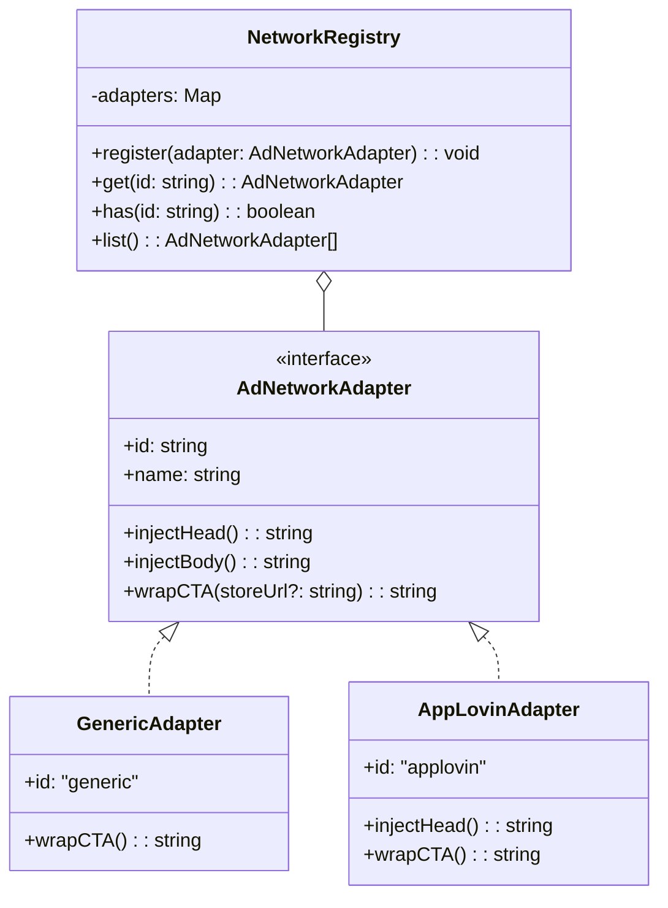

# 📘 Kế Hoạch & Hướng Dẫn Thực Hiện: Bài 10 — Lớp Trừu Tượng CTA & Strategy Pattern

> **Học phần:** Module 5: Ad Network Adapters  
> **Mục tiêu:** Xây dựng hệ thống Adapter mở rộng linh hoạt theo mẫu thiết kế **Strategy Pattern**, giúp tách rời hoàn toàn logic game khỏi sự phân mảnh API của các mạng quảng cáo (Ad Networks).

---

## 1. 📖 Lý Thuyết Nền Tảng

### 1.1. Vấn đề "Phân Mảnh" của Ad Networks (The Ad Network Fragmentation Problem)
Một Playable Ad khi xuất bản sẽ được chạy trên rất nhiều mạng quảng cáo khác nhau (AppLovin, Google Ads, Unity Ads, Mintegral, IronSource, TikTok...). Mỗi mạng lại có một chuẩn SDK và cơ chế mở kho ứng dụng (Call-To-Action - CTA) hoàn toàn khác nhau:
- **AppLovin / IronSource**: Sử dụng chuẩn MRAID (`mraid.open(url)`).
- **Google Ads**: Sử dụng script `ExitApi.exit()`.
- **Mintegral**: Bắt buộc gọi `window.install()` kèm theo việc thông báo trạng thái game (`window.gameStart()`, `window.gameClose()`).
- **Web / Preview**: Dùng lệnh điều hướng chuẩn của trình duyệt `window.open(url, '_blank')`.

> [!CAUTION]
> **Anti-pattern**: Nếu lập trình viên game viết trực tiếp `if (network === 'applovin') { mraid.open() } else if ...` vào mã nguồn game Cocos, dự án sẽ bị ghép nối quá chặt chẽ (tight-coupling), phình to kích thước và khó bảo trì khi phát sinh mạng quảng cáo mới.

### 1.2. Giải Pháp: Strategy Pattern & CTA Abstraction
Chúng ta giải quyết bằng cách thiết lập **2 ranh giới độc lập**:
1. **Đối với Game Developer**: Trong game Cocos, họ chỉ cần gọi duy nhất một hàm toàn cục đã được chuẩn hóa:
   ```javascript
   window.installClick();
   // hoặc có thể truyền storeUrl tùy chọn:
   window.installClick("https://apps.apple.com/app/id...");
   ```
2. **Đối với Playfuse Build Tool**: Áp dụng **Strategy Pattern**:
   - Định nghĩa một giao diện chung: `AdNetworkAdapter`.
   - Mỗi mạng quảng cáo là một "Strategy" riêng biệt cài đặt giao diện này.
   - Một `NetworkRegistry` đóng vai trò quản lý và cung cấp adapter thích hợp dựa trên cờ CLI `--network`.



---

## 2. 🎯 Nhiệm Vụ Cần Làm (Workload & Steps)

Bạn sẽ tự tay thực hiện các bước sau trong dự án:

### Bước 1: Định nghĩa Interface `AdNetworkAdapter`
Tạo file `src/core/adapters/types.ts`:
- Định nghĩa interface `AdNetworkAdapter`:
  ```typescript
  export interface AdNetworkAdapter {
      readonly id: string;           // Mã định danh (vd: 'generic', 'applovin')
      readonly name: string;         // Tên hiển thị (vd: 'Generic Preview')
      injectHead?(): string;        // Thẻ hoặc script tiêm vào <head>
      injectBody?(): string;        // Thẻ hoặc script tiêm vào <body>
      wrapCTA(storeUrl?: string): string; // Đoạn JS định nghĩa window.installClick
  }
  ```

### Bước 2: Xây dựng `NetworkRegistry`
Tạo file `src/core/adapters/registry.ts`:
- Quản lý danh sách các adapter trong một `Map<string, AdNetworkAdapter>`.
- Cung cấp các phương thức:
  - `register(adapter: AdNetworkAdapter): void`
  - `get(id: string): AdNetworkAdapter` (tìm kiếm không phân biệt hoa thường, ném lỗi rõ ràng nếu không tìm thấy)
  - `has(id: string): boolean`
  - `list(): AdNetworkAdapter[]`

### Bước 3: Hiện thực Adapter đầu tiên: `GenericAdapter`
Tạo file `src/core/adapters/generic.ts`:
- `id: 'generic'`
- `name: 'Generic / Web Preview'`
- `wrapCTA(storeUrl?: string)`: Sinh ra đoạn script định nghĩa `window.installClick = function(overrideUrl) { ... }` sử dụng `window.open`.
- Đăng ký sẵn `GenericAdapter` vào `NetworkRegistry`.

### Bước 4: Tích hợp Adapter vào HTML Injector & Core Engine
- Cập nhật `src/core/injector/index.ts`:
  - Thêm trường `adapter?: AdNetworkAdapter` vào `InjectorOptions`.
  - Nếu có `adapter.injectHead()`, tiêm vào `</head>`.
  - Nếu có `adapter.wrapCTA()` hoặc `adapter.injectBody()`, tiêm script vào trước thẻ đóng `</body>`.
- Cập nhật `src/core/index.ts` (`packProject`):
  - Nhận tham số hoặc tùy chọn `adapter?: AdNetworkAdapter` và chuyển giao cho `injectHTML`.

### Bước 5: Thêm cờ CLI `--network`
Cập nhật `src/cli/index.ts`:
- Đọc tham số `--network=<id>` hoặc `-n <id>` (mặc định là `generic`).
- Tra cứu adapter qua `NetworkRegistry.get(networkId)`.
- Hiển thị danh sách network hỗ trợ trong `--help`.

---

## 3. 🧪 Kế Hoạch Viết Test Cases (Unit Tests)

Tạo file test: `tests/core/adapters.test.ts`:

1. **Test `NetworkRegistry`:**
   - Đăng ký adapter thành công và lấy ra đúng theo ID.
   - Hỗ trợ tra cứu không phân biệt hoa thường (vd: `"Generic"`, `"GENERIC"`, `"generic"`).
   - Ném ngoại lệ khi gọi `get()` với ID chưa đăng ký.
   - Liệt kê đầy đủ danh sách adapter đã đăng ký.

2. **Test `GenericAdapter`:**
   - Kiểm tra `wrapCTA()` tạo ra đoạn mã chứa hàm `window.installClick`.
   - Kiểm tra cơ chế ưu tiên: Nếu có truyền `storeUrl` mặc định thì dùng `storeUrl`, nếu khi gọi `installClick(customUrl)` có URL mới thì dùng `customUrl`.

3. **Test Tích Hợp với `injectHTML`:**
   - Tiêm một mock adapter vào `injectHTML`:
     - Xác nhận nội dung của `injectHead()` nằm trong `<head>`.
     - Xác nhận nội dung `wrapCTA()` nằm trước `</body>`.
     - Xác nhận nội dung `injectBody()` nằm trước `</body>`.

---

## 4. ✅ Tiêu Chí Nghiệm Thu (Acceptance Criteria)

- [ ] **Type Safety:** 100% tuân thủ TypeScript strict, không dùng `any` bừa bãi.
- [ ] **Dependency Rules:** Thư mục `src/core/adapters/**` là Pure TypeScript, không import bất kỳ Node API nào (`fs`, `path`).
- [ ] **CLI Support:** Chạy lệnh `playfuse fixtures/cocos-3.8-basic/web-mobile output_cli --network generic` hoạt động trơn tru.
- [ ] **Browser Verification:** Mở file HTML trên trình duyệt, mở Console gõ `window.installClick()` -> mở tab mới điều hướng thành công.
- [ ] **Automated Tests:** Toàn bộ test suite `npm test` xanh 100%.

---

## 💡 Gợi Ý Dành Cho Bạn

1. Trong `wrapCTA(storeUrl?: string)`, hãy sinh ra mã JS tương thích an toàn cả khi trình duyệt chạy trên mobile browser (chú ý `window.open(targetUrl, '_blank')`).
2. Nhớ export các types và registry tại file entry `src/core/adapters/index.ts` để tiện import ở các module khác.
3. Khi bạn hoàn thành code và viết xong test, hãy thông báo: **"Nộp bài 10"** để mình review và chấm điểm nhé!
